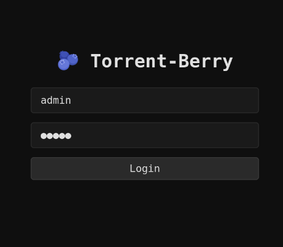

# Torrent-Berry

A lightweight BitTorrent client for low-power Linux devices such as Raspberry Pis.

Torrent-Berry provides a small web interface for adding magnet links and `.torrent`
files, monitoring downloads, and managing the queue from another device on your
network.



## Features

- Add magnet links or `.torrent` files
- Pause, resume, and remove torrents
- Download progress, transfer rates, and torrent status
- CPU, memory, and free-disk indicators
- Recovery of downloads interrupted by a restart
- Lightweight web UI designed for low-end hardware

## Requirements

- Linux on ARM or x86
- Python 3.11 or newer
- 512 MB RAM minimum; 1 GB or more recommended

## Install

```bash
git clone https://github.com/Melangert/Torrent-Berry.git
cd Torrent-Berry
chmod +x install.sh
./install.sh
```

The installer creates a virtual environment and installs the Python dependencies.

## Run

```bash
./launch.sh
```

Or run it directly:

```bash
source venv/bin/activate
python main.py
```

Open the address printed at startup, usually:

```text
http://<your-device-ip>:8000
```

The default credentials are `admin` / `admin`. Change them before exposing the
service beyond your trusted network.

## Configuration

Configuration is supplied through environment variables:

| Variable | Default | Description |
|---|---|---|
| `TORBERRY_BASE_DIR` | `~/torberry` | Base directory for application data |
| `TORBERRY_HOST` | `0.0.0.0` | Web/API bind address |
| `TORBERRY_PORT` | `8000` | Web/API port |
| `TORBERRY_SECRET_KEY` | `changeme` | JWT signing key; change this |
| `TORBERRY_USERNAME` | `admin` | Login username |
| `TORBERRY_PASSWORD` | `admin` | Login password |
| `TORBERRY_DL_LIMIT` | `0` | Download limit in bytes/s; `0` is unlimited |
| `TORBERRY_UL_LIMIT` | `0` | Upload limit in bytes/s; `0` is unlimited |
| `TORBERRY_MAX_CONNECTIONS` | `50` | Maximum peer connections |
| `TORBERRY_MAX_UPLOADS` | `4` | Maximum simultaneous uploads |
| `TORBERRY_LISTEN_PORT` | `6881` | BitTorrent listen port |
| `TORBERRY_POLL_INTERVAL` | `2.0` | Queue polling interval in seconds |

Downloaded files are stored in `~/torberry/downloads` by default. In-progress
files and the SQLite database are stored under the configured base directory.

## License

MIT
